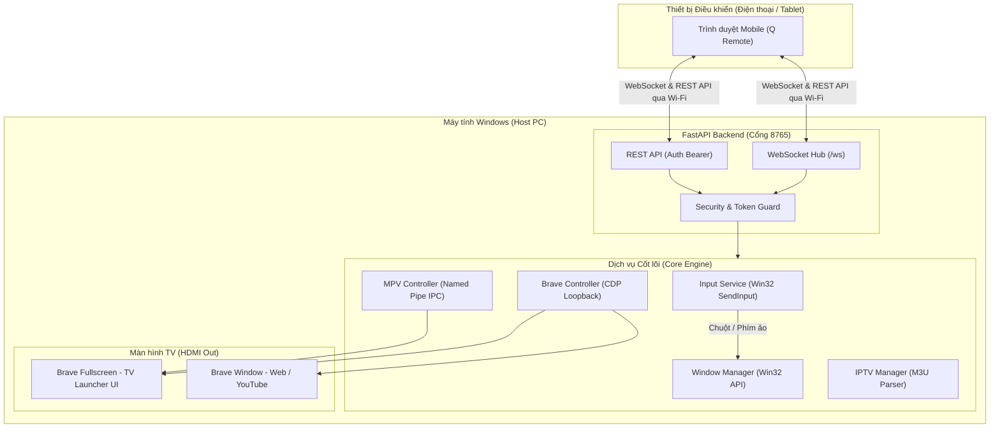

# Q Smart TV 📺

<p align="center">
  
</p>

<p align="center">
  <strong>Biến PC / Laptop Windows nối TV qua HDMI thành Smart TV thông minh, điều khiển trực tiếp bằng điện thoại qua mạng LAN không cần cài ứng dụng.</strong>
</p>

<p align="center">
  
  
  
  
  
  
</p>

---

## 🌟 Tính Năng Nổi Bật

- 🖥️ **TV Launcher Đẳng Cấp**: Giao diện toàn màn hình phong cách Luxury Glassmorphism, tối ưu hóa cho màn hình TV lớn từ xa.
- 📱 **Q Remote (Web App Di Động)**: Điều khiển TV từ bất kỳ điện thoại/máy tính bảng nào trong cùng Wi-Fi chỉ bằng cách quét mã QR:
  - **D-pad 4 Hướng & OK**: Điều hướng danh mục, chuyển kênh, mở ứng dụng nhanh chóng.
  - **Bàn di chuột ảo (Touchpad)**: Cử chỉ di chuột mượt mà, chạm để click, chạm 2 ngón click phải, cuộn trang 2 ngón và giữ để kéo thả.
  - **Bàn phím nhập liệu trực tiếp**: Hỗ trợ gõ tiếng Việt có dấu, ký tự đặc biệt, emoji, bộ đệm sửa/xóa đồng bộ thẳng vào máy tính/TV.
- 🌐 **Trình Duyệt Web & YouTube Chuyên Biệt**:
  - Tích hợp Brave Browser với cơ chế **tách biệt hồ sơ (profiles)**: Profile TV riêng biệt (`data/brave-tv-profile`), profile duyệt web ngoài độc lập (`data/brave-external-profile`), không bao giờ ảnh hưởng tới Brave cá nhân của bạn.
  - Mở YouTube hoặc bất kỳ website nào chỉ với một thao tác; thanh điều hướng thông minh hỗ trợ Back lịch sử và nút Home quay lại TV tức thì.
- 📺 **Truyền Hình IPTV & Xem Phim Media**:
  - Hỗ trợ parser danh sách kênh chuẩn Extended M3U, quản lý kênh yêu thích.
  - Tích hợp điều khiển máy nghe nhạc mpv qua Windows Named Pipe cục bộ bảo mật cao.
- 🔒 **Bảo Mật & Độ Tin Cậy Vững Chắc**:
  - Xác thực Bearer Token động cho cả REST API và WebSocket, ngăn chặn thiết bị lạ chiếm quyền điều khiển.
  - Kiểm tra và ràng buộc thư mục chặt chẽ (chống Path Traversal).
  - Không bao giờ chạy lệnh shell tùy tiện (`shell=True` bị nghiêm cấm).
- 🚀 **Khởi Động 1 Chạm Nhẹ Nhàng**:
  - Nút bấm `Q Smart TV.exe` khởi động nền mượt mà, không giật popup dòng lệnh console đen sì, quản lý tiến trình độc lập (Thoát TV không kill server, không kill Brave cá nhân).

---

## 📐 Kiến Trúc Hệ Thống



---

## 📋 Yêu Cầu Hệ Thống

1. **Hệ điều hành**: Windows 10 hoặc Windows 11 (64-bit).
2. **Python**: Python 3.10 trở lên (khuyên dùng Python 3.11 hoặc 3.12).
3. **Trình duyệt Brave**: Đã cài đặt tại đường dẫn mặc định hoặc chỉ định qua `.env`.
4. **Mạng**: PC và điện thoại kết nối vào cùng một mạng Wi-Fi/LAN (mạng Private).
5. *(Tùy chọn)* **mpv player**: Cài đặt nếu muốn xem phim cục bộ định dạng MKV/MP4 chất lượng cao.

---

## ⚡ Cài Đặt Nhanh (Quick Start)

### Bước 1: Chuẩn bị mã nguồn
Tải mã nguồn về máy tính hoặc clone bằng Git:
```powershell
git clone https://github.com/Q4k3z/Q-Smart-TV.git
cd Q-Smart-TV
```

### Bước 2: Cài đặt môi trường tự động
Nhấp đúp chuột vào file **`setup.bat`** (hoặc chạy trong terminal):
```powershell
.\scripts\setup.bat
```
Script sẽ tự động:
- Kiểm tra phiên bản Python và đường dẫn trình duyệt Brave.
- Khởi tạo môi trường ảo Python cô lập tại `.venv/`.
- Cài đặt toàn bộ các thư viện phụ thuộc từ `requirements.txt`.
- Biên dịch file chạy nhanh `Q Smart TV.exe` bằng trình biên dịch C# có sẵn của Windows.

### Bước 3: Khởi động Q Smart TV
- Nhấp đúp vào **`Q Smart TV.exe`** (hoặc chạy `start_smarttv.bat`).
- Hệ thống sẽ kích hoạt server nền và mở giao diện TV Launcher tràn màn hình.
- Bạn có thể chuột phải vào `Q Smart TV.exe` chọn **Send to -> Desktop (create shortcut)** để tiện khởi động mỗi ngày.

### Bước 4: Ghép nối Điện thoại
1. Trên màn hình TV, nhấn nút **"Kết nối Remote"** (hoặc icon QR).
2. Dùng camera điện thoại hoặc ứng dụng quét mã QR để quét mã hiển thị trên TV.
3. Trình duyệt trên điện thoại sẽ tự động mở giao diện điều khiển **Q Remote** đã được xác thực an toàn!

> [!NOTE]
> Để mở giao diện thử nghiệm trực tiếp trên PC: truy cập [http://127.0.0.1:8765/](http://127.0.0.1:8765/).

---

## 🎮 Hướng Dẫn Sử Dụng Q Remote

| Mục | Hướng dẫn thao tác |
|---|---|
| **D-pad** | Bấm 4 nút mũi tên Lên/Xuống/Trái/Phải để chuyển mục; nút tròn trung tâm là **OK** (Chọn). |
| **Phím tắt nhanh** | **Home**: Quay về trang chủ TV / Đóng website đang mở.<br>**Back**: Đóng hộp thoại hoặc quay lại trang web trước đó. |
| **Touchpad chuột ảo** | - **Di chuyển**: Vuốt 1 ngón tay trên vùng di chuột.<br>- **Click trái**: Chạm 1 ngón tay nhẹ.<br>- **Click phải**: Chạm 2 ngón tay đồng thời.<br>- **Cuộn trang**: Vuốt 2 ngón tay lên/xuống.<br>- **Kéo thả**: Nhấn giữ và kéo. |
| **Bàn phím tiếng Việt** | Bấm vào tab **Bàn phím** -> Chọn **Bắt đầu nhập** -> Gõ tiếng Việt có dấu, dán văn bản hoặc chèn emoji -> Nội dung được đồng bộ tức thì vào trường nhập trên TV/PC. |

---

## ⚙️ Cấu Hình Nâng Cao

Bạn có thể tùy chỉnh cài đặt bằng cách tạo file `.env` từ `.env.example`:

```dotenv
# Cổng và địa chỉ IP lắng nghe của server
QSMART_HOST=0.0.0.0
QSMART_PORT=8765

# Tùy chỉnh đường dẫn Brave nếu cài đặt ở ổ đĩa khác
# QSMART_BRAVE_PATH=C:\Program Files\BraveSoftware\Brave-Browser\Application\brave.exe

# Tùy chỉnh đường dẫn mpv player
# QSMART_MPV_PATH=C:\tools\mpv\mpv.exe

# Danh sách thư mục phim/media được phép quét (Path Traversal Protection)
# QSMART_ALLOWED_MEDIA_DIRS=["D:/Phim", "E:/Videos"]
```

---

## 🛠️ Xử Lý Sự Cố Thường Gặp

### 1. Điện thoại quét QR không mở được trang điều khiển
- **Cùng mạng Wi-Fi**: Đảm bảo điện thoại và PC kết nối cùng 1 modem Wi-Fi (tránh mạng Khách - Guest Network có tính năng AP Isolation).
- **Mạng Private**: Vào Windows Settings -> Network -> Chọn Wi-Fi của bạn và đặt loại mạng thành **Private network**.
- **Cấp quyền tường lửa**: Nhấp chuột phải vào file **`mo_khoa_ket_noi.bat`** chọn **Run as administrator** để cho phép cổng 8765 giao tiếp trong mạng nội bộ.

### 2. Kiểm tra sức khỏe hệ thống
Chạy công cụ chẩn đoán tích hợp:
```powershell
.\.venv\Scripts\python.exe scripts\diagnose.py
```

### 3. Tắt server hoàn toàn
Khi muốn tắt hẳn backend server chạy ngầm, chạy script:
```powershell
.\scripts\stop_server.bat
```
*(Lưu ý: Thoát giao diện TV trên màn hình chỉ đóng launcher, không tự ý tắt server hoặc tắt các cửa sổ Brave cá nhân của bạn).*

---

## 🧪 Kiểm Thử & Đảm Bảo Chất Lượng

Dự án tuân thủ nghiêm ngặt nguyên tắc phát triển có kiểm thử tự động, toàn bộ **78/78 tests** kiểm tra xác thực, token, iptv, websocket và vòng đời tiến trình đều vượt qua:

```powershell
# Chạy bộ unit test & integration test của backend
.\.venv\Scripts\python.exe -m pytest -q
```

Kiểm thử E2E tương tác thực tế với giao diện và cửa sổ (yêu cầu cài `requirements-dev.txt`):
```powershell
.\.venv\Scripts\python.exe -m pip install -r requirements-dev.txt
.\.venv\Scripts\python.exe tests\controls_smoke.py
.\.venv\Scripts\python.exe tests\lifecycle_smoke.py
.\.venv\Scripts\python.exe tests\exe_smoke.py
```

Chi tiết báo cáo kiểm thử thực tế trên máy thật có thể xem tại:
- 📖 [Báo cáo kiểm chứng hệ thống (Verification Report)](docs/verification.md)
- 📖 [Nghiên cứu kiến trúc & Giấy phép repository (Repository Research)](docs/repository-research.md)

---

## 📁 Cấu Trúc Dự Án

```
d:\Qsmarttv/
├── api/                   # REST API routes (Control, IPTV, Media, Status, WebSocket)
├── core/                  # Engine cốt lõi (Brave, Input Win32, MPV IPC, Window, Security)
├── data/                  # Dữ liệu cục bộ (Config, Playlists, Media, Logs)
├── docs/                  # Tài liệu chi tiết và kết quả kiểm chứng thực nghiệm
├── scripts/               # Các kịch bản tự động hóa, mã nguồn C# QuickStart, Firewall
├── static/                # Giao diện Web Frontend
│   ├── remote/            # Web App điều khiển di động (Q Remote)
│   └── tv/                # Web App giao diện màn hình lớn (TV Launcher)
├── tests/                 # Toàn bộ test suite (Pytest & E2E smoke tests)
├── .env.example           # File mẫu biến môi trường
├── .gitignore             # Quy tắc loại trừ tệp nhạy cảm và tệp rác
├── config.py              # Quản lý cấu hình toàn cục Pydantic/Settings
├── LICENSE                # Giấy phép mã nguồn mở MIT License
├── mo_khoa_ket_noi.bat    # Script mở cổng tường lửa Windows Firewall
├── push_to_github.bat     # Script 1-click commit & push đồng bộ GitHub
├── README.md              # Tài liệu hướng dẫn sử dụng
├── requirements.txt       # Danh sách thư viện Python chính
├── requirements-dev.txt   # Danh sách thư viện phục vụ kiểm thử
└── server.py              # Điểm khởi chạy chính của FastAPI ASGI Server
```

---

## 📄 Giấy Phép (License)

Dự án được phân phối dưới giấy phép **[MIT License](LICENSE)**. Bạn hoàn toàn tự do sử dụng, chỉnh sửa và triển khai cho mục đích cá nhân cũng như thương mại.
